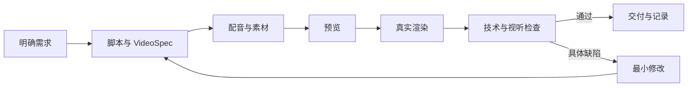

# Codex 视频生产 SOP · Video Production Loop

目的：让不同高级 AI 智能体用同一个可检查的流程，制作可复现、可修改、可批量交付的知识解说视频。Skill 已包含流程、质量规则、批量记录模板、初始化脚本、媒体验收脚本和经过本次工程提取的 Remotion 起点。

## 直接调用

在支持 Codex Skills 的环境中：

```text
使用 $video-production-loop，制作《[主题]》知识解说视频。
受众：[人群]；目标：[看完记住什么]。
时长：[秒数，是硬约束还是可调整]；画幅：[16:9 / 9:16]。
配音：[已认可音色或生成试听]；BGM：[素材路径或不使用]。
参考资料：[来源]；输出目录：[目录]。
执行制作、预览、真实渲染、抽帧、音轨与解码验证。
基于证据修订，交付 MP4、源码、配置和质量记录。
```

其他智能体：解压 `video-production-loop.zip`，读取其中 `SKILL.md`，按相对路径加载所需资源。无需依赖 Codex 内部工具；根据所在环境替换命令执行、浏览器和试听工具。

## 核心闭环



反馈循环必须记录：问题、证据、修改、回归结果。达到约定验收范围即可交付；默认最多三轮自动质量修订，用户的新反馈可开启新一轮。缺依赖时准确报告阻塞，不能用源码或旧片充当成片。

## 每轮执行清单

1. 写清核心观点、受众、硬时长、画幅和素材约束。核实事实；图解示意与实测数据区分。
2. 写适合口述的文案和场景，不用字幕长文堆满画面。按真实合成后的时长调整稿件或镜头。
3. 先试听声音，再批量合成。对白太慢同时检查语速、句中停顿、段尾静音；不要只提高语速却留下更长空档。
4. BGM 选段记录源文件、起止秒、方法。能量峰值只能选出候选；有对白时从低约 16–22 dB 的音乐电平开始试听。
5. 预览中文、层级、边距、切换与声音。画面默认不带工具品牌角标。
6. 实际渲染到独立修订目录；核对帧数、时长、尺寸、帧率、音轨、完整解码。从成片抽帧，不只看编辑器。
7. 区分技术通过和视听通过。未听审要写明；不能把峰值正常称为“自然好听”。
8. 交付新文件与源码、依赖锁、来源、验收记录；保留旧版本，更新最新版本指针。

## 批量制作

先选代表性样片，通过后再铺开。将主题表转换成 `assets/batch-plan.json` 的 jobs；每个 job 使用独立工程和修订目录。默认同时渲染一个视频、内部并发 2，按实测资源调整。

失败只阻塞受影响任务；共享服务失效时统一暂停依赖它的任务。恢复时对比配置和资源哈希，跳过真正未变化的结果。最后交付逐项成功/失败/待检查清单，而不是笼统说“全部完成”。

```text
使用 $video-production-loop，根据这份主题表批量制作视频。
复用已认可的样片风格，各主题独立脚本和素材来源。
先完成代表性样片，再继续剩余任务。
遵循每项独立目录、有限重试、失败隔离和断点恢复。
不要发布到外部平台，交付本地成片、源码和逐项质量记录。
```

## 本次可复用预设

横屏 1080p、30fps、30 秒；云希神经男声 +10%；对白前留白 80ms；低音量大提琴背景、1 秒淡入和 2 秒淡出；深色信息图；无 Codex/Remotion 角标。

这些参数是本次反馈形成的默认候选，不是通用规则。BGM 音量倍率必须对新素材重新测量；用户歌曲、绝对路径和生成历史未放入通用 Skill。附带模板默认静音，避免缺素材导致首次渲染失败；制作有声视频时需要主动启用旁白并配置自己的音频。

## 包内入口

- `SKILL.md`：智能体执行入口与阶段门槛。
- `references/production.md`：脚本、音频、音乐、画面和依赖。
- `references/quality-loop.md`：验收与反馈修订。
- `references/batch.md`：批量状态、缓存、重试和恢复。
- `references/accepted-profile.md`：本次认可样片及证据边界。
- `scripts/bootstrap.py`：复制模板到新目录，拒绝覆盖已有工程。
- `scripts/verify_media.py`：媒体规格、全片解码、音频信号与抽帧。
- `assets/remotion-starter/`：五种基础场景的可执行工程。
- `assets/batch-plan.json`、`assets/run-record.json`：批量计划和单项状态模板。
